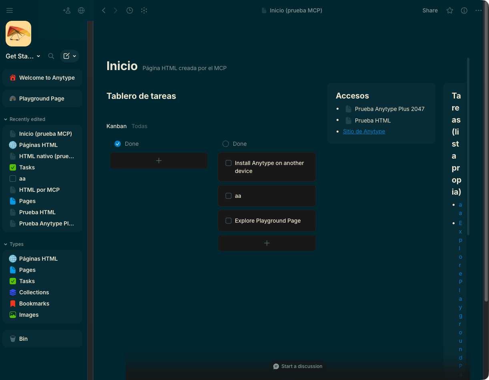
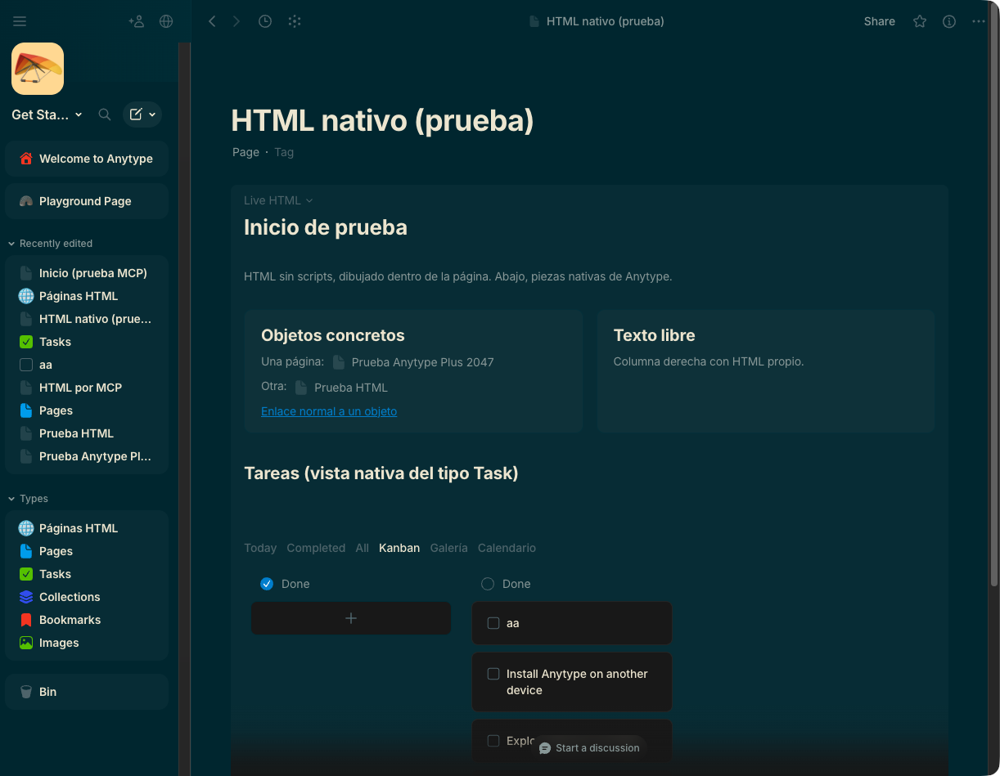

# Anytype Plus

Fork personal del cliente de escritorio de Anytype ([anyproto/anytype-ts](https://github.com/anyproto/anytype-ts), base `v0.57.7`) que agrega páginas HTML vivas, formato de páginas, temas y avisos de cambios para un equipo, **sin dejar la red oficial de Anytype**: se entra con la misma cuenta, se ven los mismos espacios y quien usa el Anytype oficial sigue viendo algo razonable.

*A personal fork of the Anytype desktop client (Electron, React, TypeScript) that adds live HTML pages and blocks able to embed native Anytype views, page layout options, Solarized themes, a DOCX viewer and a team change inbox, while staying fully compatible with the official Anytype network.*

| Página HTML con un kanban nativo incrustado | Bloque HTML vivo con objetos y vistas nativas |
|---|---|
|  |  |

Capturas en un espacio de prueba.

## Qué agrega

- **Páginas HTML:** un tipo de objeto que se ve como una página web dentro de Anytype, con modo vista y modo edición, que puede enlazar objetos y mostrar vistas nativas (por ejemplo un kanban). Pensado para que una IA las cree por MCP.
- **Bloque HTML** dentro de cualquier página, para widgets chicos, con un sanitizador propio.
- **Formato de páginas:** columnas que encajan en una grilla, fuente y tamaño de texto, estilos de bloque.
- **Vista por carpetas:** documentos ordenados con las carpetas del repositorio del que vienen.
- **Visor de DOCX** y documentos incrustados dentro de otros.
- **Temas Solarized** claro y oscuro.
- **Avisos y bandeja de cambios:** qué editó cada persona del equipo, agrupado para que una edición masiva no llene de avisos.
- **Actualizaciones** desde GitHub Releases con instaladores para Mac (arm64 y x64), conectando la cuenta de GitHub por device flow y guardando el token en el llavero del sistema.

## La regla de oro

1. No se toca `anytype-heart` (el motor en Go): se usa el que publica Anytype para la versión base.
2. Todo lo nuevo se guarda con piezas que heart ya conoce (campos de bloque, bloques de código, el embed «Mini App», tipos y propiedades del espacio).
3. Quien abre un objeto nuestro con el Anytype oficial ve el código o un enlace, nunca un error.

El detalle de cómo se guarda cada cosa está en [ARQUITECTURA.md](ARQUITECTURA.md).

## Cómo está organizado

- Código propio en carpetas aparte: `plus/`, `src/ts/plus/`, `src/scss/plus/` y `electron/ts/plus/`.
- Los toques al código de Anytype son mínimos y van marcados con `// plus:`, para que traer versiones nuevas no duela.
- Pruebas con Vitest junto a cada módulo (`*.test.ts`): sanitizador, carpetas, avisos, bandeja de cambios, listas y actualizaciones.
- Toda la diferencia con el original es un solo commit encima del tag `v0.57.7` en la rama `anytype-plus`.

## Documentos

| Documento | Para qué |
|---|---|
| [ARQUITECTURA.md](ARQUITECTURA.md) | Cómo se guarda cada función y qué ve el Anytype oficial |
| [DISENO_HTML.md](DISENO_HTML.md) | Cómo se integra el HTML: modos, etiquetas propias, MCP y la lista de "se siente nativo" |
| [GUIA_HTML_PARA_IA.md](GUIA_HTML_PARA_IA.md) | Cómo crear y editar páginas HTML por MCP: llamadas exactas y HTML permitido |
| [notas/](notas/) | Notas de versión |

## Correr en desarrollo

Igual que Anytype (ver [CLAUDE.md](../CLAUDE.md)): `bun install`, `./update.sh` (baja heart ya compilado), `bun run generate:protos` y `bun run start:dev`. Las actualizaciones automáticas quedan apagadas hasta configurar `plusUpdate` en `package.json`.

## Licencia

El cliente de Anytype se publica con la Any Source Available License 1.0 ([LICENSE.md](../LICENSE.md)), que permite usar, modificar y redistribuir sin fines comerciales. Este fork es de uso personal y no se vende.

Hecho con asistencia de IA; el diseño de las funciones y la arquitectura de compatibilidad son míos. Juan Francisco Domenech Rossello · [justhipo.github.io](https://justhipo.github.io)
